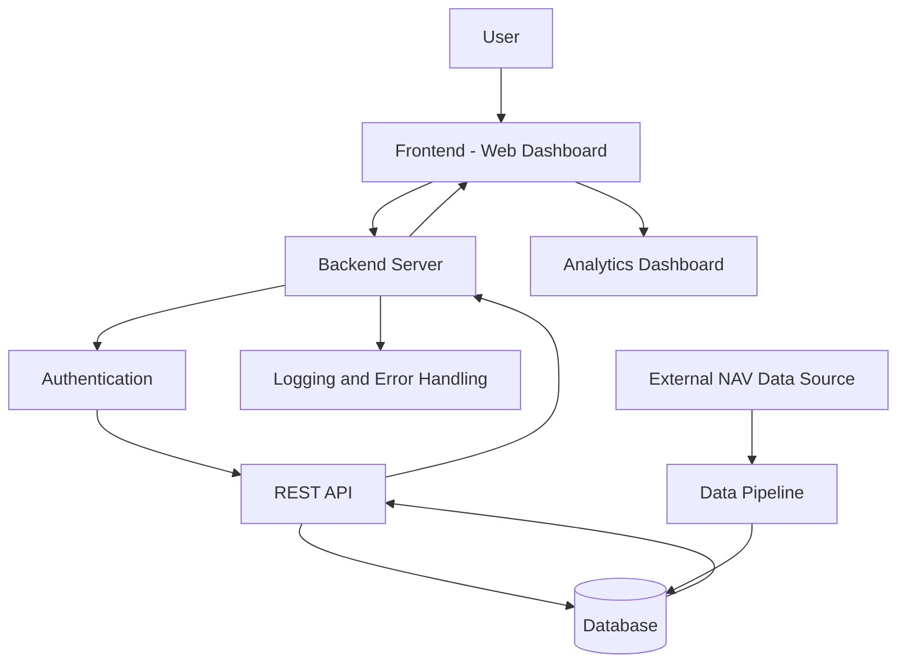

# Software Architecture Diagram
## Example: Mutual Fund Dashboard

### Architecture Flow

### Component Descriptions

1. **User:** Opens the application and requests mutual fund information.
2. **Frontend:** Displays the login page, portfolio, NAV, and performance charts.
3. **Backend Server:** Processes requests and applies business rules.
4. **Authentication:** Verifies the user's identity and access permissions.
5. **REST API:** Transfers requests and responses between the frontend and backend.
6. **Database:** Stores user information, fund details, NAV history, and transactions.
7. **Data Pipeline:** Collects, cleans, and loads external NAV data into the database.
8. **Analytics Dashboard:** Displays portfolio value, returns, and other metrics.
9. **Logging and Error Handling:** Records events and manages failures.

### Example Data Flow

1. The user requests their mutual fund portfolio.
2. The frontend sends an API request to the backend.
3. The backend verifies the user's authentication.
4. The backend retrieves relevant data from the database.
5. The backend returns the result to the frontend.
6. The dashboard displays the portfolio and performance charts.
7. The application records important events and handles errors when they occur.

### Conclusion

This architecture demonstrates how a FinTech web application connects users, frontend components, backend services, APIs, databases, and analytics. A data pipeline keeps fund information updated, while logging and error handling improve reliability.
